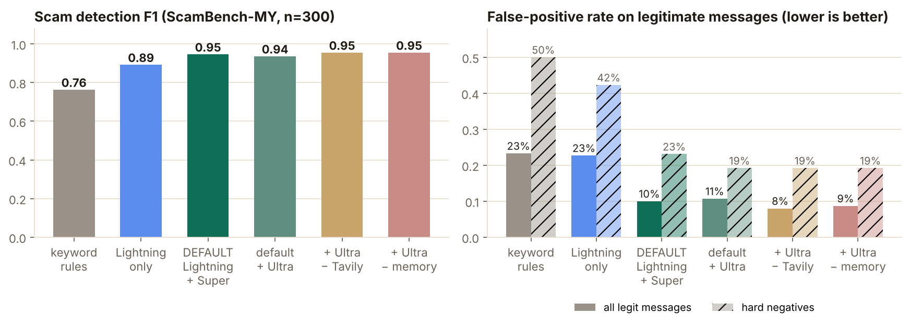
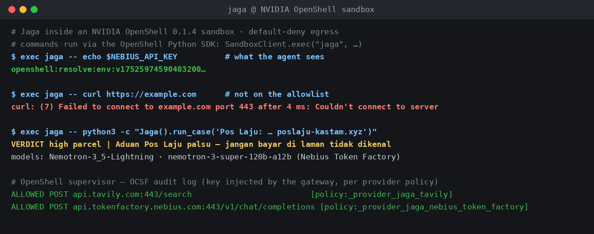

# 🛡️ Jaga — a private scam guardian that verifies before it warns

**Jaga** (Malay: *to guard*) is an always-on scam guardian for Malaysian seniors and the adult
children who look after them. Forward it a WhatsApp/SMS message **or a screenshot** on Telegram; it
checks the names, numbers and links against **official Malaysian alert lists** (Securities Commission,
PDRM, Bank Negara, MCMC), consults what it remembers about the household, answers in Bahasa Malaysia
and English — and quietly tells the family, with evidence, when something is wrong.

> Malaysians lost **RM2.97 billion** to online fraud in 2025, and **1,916 seniors lost over RM250
> million** in a single year. The messages that take their savings arrive on a phone nobody else sees.

**Track:** Personal AI · **Live demo:** https://jaga-q6pu.onrender.com · **Telegram:**
[@Jaga_my_demo_bot](https://t.me/Jaga_my_demo_bot) · Nebius x NVIDIA Global AI Hackathon 2026

<p align="center"></p>

**The 30-second version.** On 15 October 2026 the Securities Commission added *"RRJ Pro"* to its
Investor Alert List. One day later, a message pitching "RRJ Pro, 30% a month, guaranteed" was
forwarded to Jaga. Nemotron extracted the scheme name, Tavily found the SC announcement, and Jaga
answered *"Waspada! RRJ Pro dalam senarai amaran SC"* — quoting the exact line from the SC page.
No model's training data contains that fact; a verifying agent finds it.

---

## How Jaga uses Nebius and NVIDIA

| Layer | What Jaga does with it | Why it's load-bearing |
|---|---|---|
| **Nemotron 3.5 Lightning** `nvidia/Nemotron-3_5-Lightning` on **Nebius Token Factory** | Triage of every message, **thinking off**, JSON-schema structured output: scam family, entities (schemes, phones, links, accounts), urgency cues | Cheap, fast tier for the step that runs on every message |
| **Nemotron 3 Super** `nvidia/nemotron-3-super-120b-a12b` | **Thinking on, budgeted.** Plans what to verify (entity → tool → query), then writes the bilingual verdict from *verified facts only* | The judgment step. Halves false alarms vs Lightning alone (see Results) |
| **Nemotron 3.5 Super VL** `nvidia/Nemotron-3.5-Super-VL` | Reads forwarded **screenshots**: transcribes the message, the sender as displayed, and visual red flags | Seniors forward screenshots; VL spotted "Maybank Customer Care" on a personal +60 11 number unprompted |
| **Nemotron 3 Ultra** `nvidia/Nemotron-3-Ultra-550b-a55b` | Optional second opinion on money-involved, ambiguous cases (`JAGA_TIER=full`) | Evaluated honestly: no measurable gain on ScamBench-MY at +15% cost, so opt-in |
| **Tavily** search (`include_domains`, `include_raw_content`), news, extract, map | Model-chosen lookups restricted to SC / PDRM / BNM / MCMC / NSRC; nightly map→extract cache; 24 h response cache | Freshness: the RRJ Pro alert was one day old |
| **NVIDIA OpenShell 0.1.4** | Jaga's pipeline **verified running inside an OpenShell sandbox**: default-deny egress, keys held by the gateway | The sandbox only ever sees `openshell:resolve:env:…` placeholders. See [hermes/OPENSHELL_RUN.md](hermes/OPENSHELL_RUN.md) |
| **Household ledger** (SQLite) | Structured two-subject memory written deterministically after every case; OCSF-style audit | Trust is earned by a *saved phone number*, never a typed name |

Model IDs live in `.env` with fallback chains; `/health` shows what resolved live.

## Results — ScamBench-MY (300 messages) and a memory test (20)

`eval/data/scambench_my.jsonl`: 300 hand-written messages, 150 scams across 6 families
(impersonation, investment, love, mule, parcel, phishing/OTP) and 150 legitimate messages — 52 of
them *hard negatives* that look like scams (genuine TAC warnings, real courier fees, a daughter asking
for money). 40% Bahasa Malaysia, 35% English, 25% Manglish. All live runs on Nebius Token Factory.

<p align="center"></p>

| Configuration | F1 | Scams caught | False alarms on legit | USD / 1,000 msgs |
|---|---|---|---|---|
| Keyword rules (no model) | 0.763 | 76.0% | 23.3% | — |
| Nemotron 3.5 Lightning only | 0.892 | 98.7% | 22.7% | $0.18 |
| **Default: Lightning + Super + Tavily + memory** | **0.946** | **98.7%** | **10.0%** | **$2.18** |
| Default + Nemotron 3 Ultra second opinion | 0.936 | 97.3% | 10.7% | $2.51 |
| … + Ultra, without Tavily | 0.955 | 98.7% | 8.0% | $2.55 |
| … + Ultra, without household memory | 0.955 | 99.3% | 8.7% | $2.51 |

**What the numbers say** (95% paired-bootstrap CIs in [eval/results/CI.md](eval/results/CI.md)):

* **Tiering works.** Adding Super's planning and verdict to Lightning **halves false alarms**
  (22.7% → 10.0%) at the same recall: ΔF1 +0.054 [+0.025, +0.089], ΔFPR −12.7 pts [−19.9, −6.0].
  Lightning alone is an excellent detector but too jumpy to trust with a senior's phone.
* **Ultra didn't earn its cost here** (ΔF1 −0.010 [−0.033, +0.013]), so it's opt-in rather than default.
* **Tavily and memory don't move aggregate F1 on ScamBench-MY — by design of the benchmark.** Its
  scam names and numbers are fictional, so no official list contains them, and none of its messages
  come from the household's saved contacts. Their value shows where the benchmark can't: real,
  newly-listed entities (RRJ Pro, cited above) and known contacts —

**Memory test** (`eval/data/memory_set.jsonl`, 20 messages): 10 genuine, urgent-sounding messages
from saved contacts (daughter, insurance agent, doctor) and 10 impersonations of the *same people*
from new numbers ("Mum, it's Siti, new number…").

| Configuration | Impersonations caught | Genuine messages wrongly flagged |
|---|---|---|
| Lightning only | 10 / 10 | 2 / 10 |
| default **without** memory | 10 / 10 | 3 / 10 |
| **default with memory** | **10 / 10** | **0 / 10** |

Small sample — directional, not proof. It also caught a real bug: an earlier version trusted a
contact's *name*, which cleared "Mum, it's Siti, new number". Trust now requires the saved number,
and a saved name from an unsaved number is itself a red flag (`tests/test_pipeline.py`).

---

## Technological Implementation

```
Senior / guardian ── Telegram or dashboard ──▶ Jaga
   screenshot? ─▶ Nemotron 3.5 Super VL (transcribe + visual red flags)
   Nemotron 3.5 Lightning ── triage (thinking off, strict JSON schema)
   regex backstop ── phones / links / accounts the model missed
   household ledger ── trusted matches (by saved number) + novelty flags
   Nemotron 3 Super ── verification plan (thinking on, budget 2.5k)
   policy floor ── every named entity in a scam-pattern message gets ≥1 official lookup
   Tavily ── official-domain search ∥ news ∥ cache (parallel, 24 h cached)
   relevance check ── a page counts only if the entity is literally on it
   Nemotron 3 Super ── verdict from verified facts only (BM + EN)
   policy in code ── evidence rebuilt from verified hits, NSRC 997 on high risk, never "safe"
   [optional] Nemotron 3 Ultra ── second opinion on money + ambiguity
   ledger.record_case ── deterministic memory + audit; guardians get a summary, never the message
```

Engineering details judges may care about, each found by live testing and fixed in code:

* **Strict schemas.** Nemotron's guided decoding skipped optional fields (entities came back empty);
  every schema is sent with all properties `required` and bounded `maxItems`/`maxLength`
  (`jaga/llm.py:strict_schema`). Bounded lists also stopped a repetition loop in Lightning.
* **No invented sources.** The model once cited a real Bank Negara page for a phone number that isn't
  on it. Web evidence is now rebuilt solely from deterministic tool hits, and the verdict model only
  sees verified facts (`jaga/pipeline.py:_enforce_policy`, regression test included).
* **Degradation.** Model fallback chains (404/429), a "paused" state on HTTP 402, a 24 h search cache,
  `JAGA_MOCK=1` offline mode for tests and a recorded-run fallback.

## Design

A complete loop: Telegram in → bilingual card back → guardian summary → family dashboard with verdict
cards and cited evidence, a "how Jaga decided" trace (model per step, checks, cost, latency), memory
viewer and trusted-contact editor, a **policy page** (who is told what), an **audit timeline**, export
and delete-all. A progress overlay explains the 15–20 s verification. Zero setup for the senior.

## Potential Impact

Sources: Home Ministry parliamentary reply via
[Malay Mail](https://www.malaymail.com/amp/news/malaysia/2026/06/24/online-scam-losses-surge-to-rm297b-in-2025-says-home-ministry-as-fraud-trend-worsens-across-malaysia/225000);
Bukit Aman via [The Sun](https://thesun.my/malaysia-news/1916-elderly-victims-fall-prey-to-online-scams-losing-over-rm250-million-this-year-JH13053183);
NHMS 2025 via [Malay Mail](https://www.malaymail.com/news/life/2026/10/12/malaysias-ageing-population-raises-alarm-over-lonely-deaths-how-does-smart-tech-help/238728).
At $2.18 per 1,000 messages, a household forwarding 20 messages a month costs about US$0.50
(≈ RM2.30) a year in inference. Jaga is decision support: it never says "safe" and always points high-risk cases to
**NSRC 997**.

## Quality of the Idea

Most "AI vs scams" demos are classifiers. Jaga **verifies**: the model decides what to check, Tavily
fetches the authority page, code confirms the entity is really on it, and only then is it cited.
Memory is structured and two-subject (the protected parent and the guardians). Privacy is enforced in
code and in an OpenShell policy, not promised in a prompt.

---

## Privacy and NVIDIA OpenShell

Jaga's case pipeline runs inside an **NVIDIA OpenShell 0.1.4** sandbox under a default-deny egress
policy that allows only Nebius Token Factory, Tavily and Telegram. The Nebius and Tavily keys stay in
the OpenShell gateway: the sandbox only ever sees `openshell:resolve:env:…` placeholders, and the
proxy injects the real key only for its own host.

<p align="center"></p>

Tested on 16 Oct 2026 with the gateway container and the OpenShell Python SDK; commands, evidence
and a 12-item friction log are in [hermes/OPENSHELL_RUN.md](hermes/OPENSHELL_RUN.md); reproduce with
`bash hermes/setup_nemohermes.sh`. **Not yet run under OpenShell:** the NemoClaw/Hermes Agent
onboarding (`nemohermes` is not published on PyPI or npm yet) and the Telegram gateway. The public
demo on Render is a normal web service: keys are server-side environment variables there, and the
dashboard's policy page says so.

## Quickstart

```bash
git clone https://github.com/ShermaineYap/jaga && cd jaga
pip install -r requirements.txt
cp .env.example .env                 # NEBIUS_API_KEY, TAVILY_API_KEY, optional TELEGRAM_BOT_TOKEN
python scripts/list_models.py        # confirm Nemotron IDs on your Token Factory account
python scripts/seed_demo.py          # demo household + 3 cases (incl. RRJ Pro)
uvicorn jaga.dashboard.app:app --port 8000
python -m jaga.bot                   # Telegram gateway
```

No keys? `JAGA_MOCK=1` runs everything offline. `make test` runs 11 tests.
Evaluation: `python eval/run_eval.py` (≈ $3 of Token Factory credit for all configurations),
`python eval/bootstrap.py`, `python eval/charts.py`.
Deploy: `render.yaml` (one-click Blueprint) or `docker compose up -d`.

**Judges:** `POST https://jaga-q6pu.onrender.com/api/check` with `{"text": "..."}` returns the full
case JSON; `/health` shows the live model IDs. The free instance sleeps when idle — the first request
can take ~50 s to wake.

## Known limitations

* No voice notes yet: Token Factory has no speech model.
* Malay isn't in Nemotron's documented languages. It worked well here (18/20 on day one; per-language
  F1 in `eval/results/RESULTS.md`), but formal Malay is weaker than Manglish.
* PDRM Semak Mule is a form lookup that search can't reach; phone-number checks rely on SC/BNM/news.
* ScamBench-MY is hand-written by the author; it is a sanity benchmark, not a field study.

## Feedback on Token Factory, Tavily, OpenShell and Nemotron

[docs/FEEDBACK.md](docs/FEEDBACK.md) — concrete issues we hit, with exact symptoms and workarounds.

## License

MIT — see [LICENSE](LICENSE).
