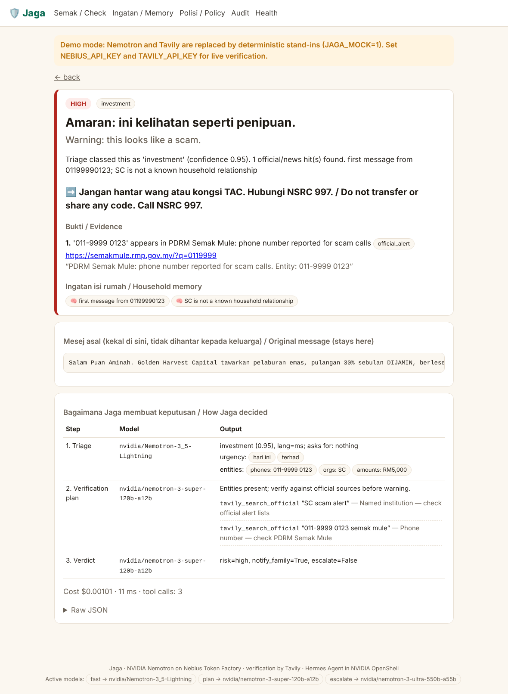

# 🛡️ Jaga — a private guardian that verifies before it warns

**Jaga** (Malay: *to guard*) is an always-on, private scam-shield for Malaysian seniors and the
adult children who look after them. Forward it a WhatsApp, SMS or Telegram message and it checks
the names, numbers and links against **official Malaysian alert lists** (Securities Commission,
PDRM Semak Mule, Bank Negara, MCMC), consults what it remembers about the household, and quietly
tells the right person — with evidence — when something is wrong.

> Malaysians lost **RM2.97 billion** to online fraud in 2025. In one year **1,916 elderly victims
> lost over RM250 million**, and **~770,800 Malaysians over 60 now live alone**. The messages that
> take their savings arrive on a phone nobody else sees — so the guardian has to live on that phone,
> and it has to be private.

**Track:** Personal AI · **Bonus:** Best Use of Tavily · Nebius x NVIDIA Global AI Hackathon 2026

<p align="center"></p>
<p align="center"><sub>Verdict card (demo mode). <code>docs/demo.gif</code>: 30-second forward → verdict → guardian-summary recording, added with the video.</sub></p>

---

## How Jaga uses Nebius and NVIDIA (the short version)

| Layer | What | Why it is load-bearing |
|---|---|---|
| **NVIDIA Nemotron 3.5 Lightning** (`nvidia/Nemotron-3_5-Lightning`) on **Nebius Token Factory** | Triage every message with **thinking off** and **JSON-schema structured output**: scam family, entities, urgency cues, what the sender asks for | Cheap, fast, 1M-context tier for the step that runs on every message |
| **NVIDIA Nemotron 3 Super** (`nvidia/nemotron-3-super-120b-a12b`) on Token Factory | **Thinking on, client-side budget.** Plans verification (which entity → which tool), then writes the verdict where **every claim cites a URL or household memory, or says "none found"** | Long-horizon planning + tool decisions; the judgment step |
| **NVIDIA Nemotron 3 Ultra** (`nvidia/nemotron-3-ultra-550b-a55b`) on Token Factory | Second opinion only when money is involved and evidence is thin | Keeps the strongest model for the few cases that need it (cost stays in cents) |
| **Token Factory Batch API** | The ScamBench-MY evaluation sweep | Higher limits, cheaper, one more surface judges can see in `eval/` |
| **Tavily** Search (`include_domains`), Extract, Map | Model-decided verification against SC / PDRM / BNM / MCMC; nightly Map→Extract cache of the alert lists | Freshness is the whole point: a scheme added to the SC list yesterday is what a static model cannot know |
| **NVIDIA OpenShell + NemoClaw + Hermes Agent** | The agent runs in an OpenShell sandbox with a **default-deny network** (3 hosts), credential-hiding inference routing to Token Factory, OCSF audit; Hermes gives the Telegram gateway, cron and the checked-in `jaga_case_protocol` skill | Privacy is a policy file in this repo, not a slide |
| **Household ledger** (SQLite) | Structured two-subject memory written **deterministically after every case** | Fixes the documented gap in OpenClaw/Hermes memory (agent-curated plaintext, lost at compaction); novelty features like *"payee never seen before"* are themselves scam signals |

Model IDs live in `.env`, never in code; each role has a fallback chain; `/health` shows the active
IDs. See [docs/ARCHITECTURE.md](docs/ARCHITECTURE.md) for the full diagram.

---

## Technological Implementation

```
Senior / guardian ── Telegram (Hermes gateway) ──▶ OpenShell sandbox (nemohermes)
                                                   │  egress: tokenfactory · tavily · telegram only
                                                   │
   Lightning (thinking off, JSON) ── triage ───────┤
   ledger.context_for() ── trusted matches, novelty flags
   Super (thinking on, budget) ── verification plan ─┤──▶ Tavily search_official / search_news / alert_cache
   Super ── verdict with cited evidence ─────────────┤
   Ultra ── second opinion if verdict.escalate ──────┤
   ledger.record_case() ── deterministic memory + OCSF audit
   notify ── guardians get risk + headline + action, never the message
```

* `jaga/llm.py` — Token Factory client: structured output, `chat_template_kwargs.enable_thinking`,
  reasoning budgets, cost accounting, 404/402/429 degradation along the chain.
* `jaga/pipeline.py` — the loop above; every step is an ablation switch.
* `jaga/tavily_tools.py` — deterministic tools, testable without a model; a result only counts as
  evidence if the entity itself appears in it.
* `jaga/ledger.py` — structured memory + audit; export / delete-all.
* `hermes/` — `SKILL.md`, `openshell-policy.yaml`, `jaga_tools.py`, `setup_nemohermes.sh`.
* `eval/` — ScamBench-MY (300 labelled BM/EN/Manglish messages) + harness + charts.

## Design

A complete loop, not a proof of concept: Telegram in → verdict card in Bahasa Malaysia and English
→ guardian summary → family dashboard with verdict cards, cited evidence, **memory viewer**,
**policy screen** (who is told what; the OpenShell network policy rendered), **audit timeline**
("what Jaga did with your data"), export and delete-all. Zero setup for the senior beyond
forwarding a message.

## Potential Impact

Sources for the numbers above: Home Ministry parliamentary reply (RM2.97b, 2025) via
[Malay Mail](https://www.malaymail.com/amp/news/malaysia/2026/06/24/online-scam-losses-surge-to-rm297b-in-2025-says-home-ministry-as-fraud-trend-worsens-across-malaysia/225000);
Bukit Aman elderly victims via [The Sun](https://thesun.my/malaysia-news/1916-elderly-victims-fall-prey-to-online-scams-losing-over-rm250-million-this-year-JH13053183);
NHMS 2025 on seniors living alone via [Malay Mail](https://www.malaymail.com/news/life/2026/10/12/malaysias-ageing-population-raises-alarm-over-lonely-deaths-how-does-smart-tech-help/238728).
Jaga is decision support: it never says "safe", always shows evidence, and for high risk always
points to **NSRC 997**.

## Quality of the Idea

Most "AI vs scams" demos are classifiers. Jaga **verifies**: the model decides what to check, Tavily
fetches the authority page, and the verdict cites it — or says plainly that nothing was found.
Memory is two-subject and structured, so the planner knows that *Encik Faizal from Prudential* is
Mum's real agent and that *this payee has never been seen before*. Privacy is enforced in code and
policy (summary-only notifications, default-deny egress, audit), not promised in a prompt.

---

## Results — ScamBench-MY

`eval/data/scambench_my.jsonl`: 300 labelled messages (150 scam across 6 families, 150 legitimate
of which ~35% are *hard negatives* that share surface features with scams), ~40% BM / 35% EN /
25% Manglish. Metrics: F1, **false-positive rate on legitimate messages** (the number that decides
whether a family keeps using it), per-family recall, per-language F1, median latency, USD per
1,000 messages at Token Factory list prices, with ablations (−Tavily, −memory) and a rules-only
baseline.

<p align="center"></p>

The committed `eval/results/RESULTS.md` is produced by `make eval` (live) or `make eval-mock`
(offline heuristics baseline). The live sweep costs roughly $1–3 of Token Factory credit.

A 500-question **MalayMMLU** subset (`scripts/malaymmlu_subset.py`) gives an honest Bahasa Malaysia
number for Nemotron — reported in [docs/FEEDBACK.md](docs/FEEDBACK.md).

---

## Quickstart (5 minutes)

```bash
git clone https://github.com/<you>/jaga && cd jaga
pip install -r requirements.txt
cp .env.example .env          # add NEBIUS_API_KEY, TAVILY_API_KEY (TELEGRAM_BOT_TOKEN optional)

python scripts/list_models.py # day-one: confirm Nemotron IDs on Token Factory
python scripts/seed_demo.py   # demo household + 3 demo cases
uvicorn jaga.dashboard.app:app --port 8000   # http://localhost:8000
python -m jaga.bot            # Telegram gateway (standalone; Hermes replaces this in the OpenShell deployment)
```

No keys? `JAGA_MOCK=1` runs everything with deterministic stand-ins (that is also the recorded-run
fallback if credits are exhausted during judging). `make test` runs the offline suite.

**Judges:** demo URL and test credentials are in the Devpost submission. `POST /api/check
{"text": "..."}` returns the full case JSON. `/health` shows the live model IDs.

### Hermes Agent inside NVIDIA OpenShell

```bash
export NEBIUS_API_KEY=… TAVILY_API_KEY=… TELEGRAM_BOT_TOKEN=…
bash hermes/setup_nemohermes.sh      # nemohermes onboard → inference set → policy apply → skill + cron
```

### Docker

```bash
docker compose up -d   # dashboard :8000, Telegram bot, nightly alert-cache refresh
```

## Known limitations

* **Text and screenshots-as-text only.** Nebius removed NVIDIA's multimodal models (Nemotron 3 Nano
  Omni, Cosmos Reasoner) from Token Factory serverless on 31 Aug 2026 and Token Factory has no
  speech product, so voice notes are a documented next step (Cosmos Reason 2 on a Serverless
  Endpoint, or a speech model when one returns).
* Nemotron's documented languages do not include Malay. We measured it (MalayMMLU subset) and route
  accordingly; see FEEDBACK.md.
* Jaga is decision support, not an official warning service. It cites SC / PDRM / BNM pages; it
  never speaks as them.

## Feedback on Token Factory, AI Cloud, NVIDIA tools

See [docs/FEEDBACK.md](docs/FEEDBACK.md) — what each tool was used for, what worked, what needs
work, zero-to-hello-world time, and whether we would build with them again.

## License

MIT — see [LICENSE](LICENSE).
